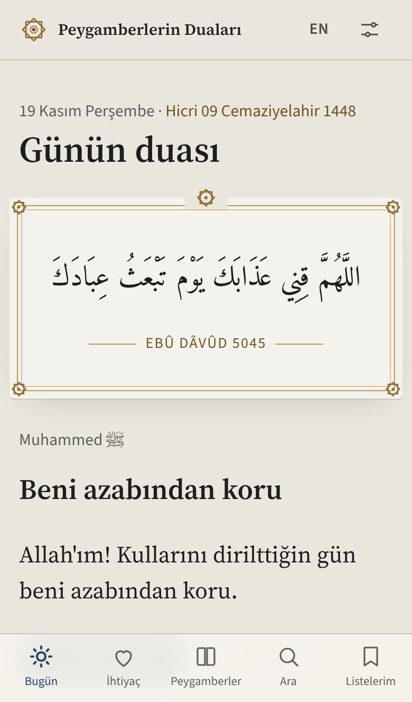
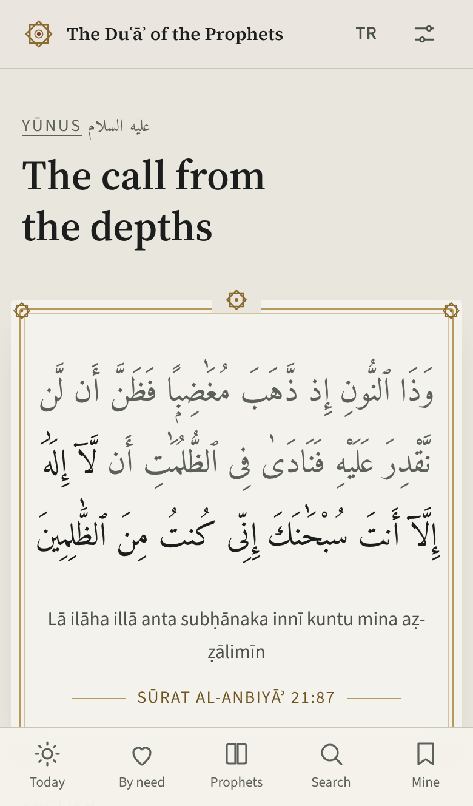

# The Duʿāʾ of the Prophets

A free website with the supplications of the Prophets from the Qurʾān and the
Sunnah — Arabic, transliteration, English and Turkish translation, and the
occasion each was said on — for anyone looking for the right words to pray.

### **[Open the site →](https://candanumut.github.io/dua/)**

Works on your phone; add it to your home screen. After the first visit the
whole site works offline.

<p>
  
  
  
</p>

## What you get

- **82 supplications** — 57 from the Qurʾān and 25 from the Sunnah — each with
  the Arabic in full, a transliteration, an English and a Turkish translation,
  the source and grading, and when and why it was said.
- **Today**: a duʿāʾ for each day, the date in both calendars, where you left
  off, and your lists — one tap from opening the site.
- **Through the day**: what the Prophet ﷺ said on waking, in the morning and
  evening, leaving the house, at the mosque, after prayer, after eating,
  travelling, in rain, pain and anguish, and going to sleep.
- Find a duʿāʾ **by need** (sixteen situations), **by prophet**, or with search
  in Arabic, transliteration, English or Turkish.
- **Reading mode** with swipe, the screen kept awake, and a **memorisation**
  mode that hides the Arabic word by word or leaves the first letters.
- **Recitation** of every Qurʾānic entry, āyah by āyah.
- **Lists** of your own ("Morning", "For my parents"), saved entries, recently
  read, **backup and restore**, and a **daily reminder** added to your phone's
  calendar.
- **Share as an image** — the Arabic, the translation and the citation, ready
  for a message or a story.
- The whole site in **English and Turkish**, light or dark, three text sizes.

## How the text is handled

The Arabic is never typed by hand. The Qurʾān is taken from a published
edition (`quran-uthmani`) and the ḥadīth from an open edition of the
collections, by collection and number; both are checked against a fingerprint
(`content.lock.json`, `hadith.lock.json`) on every build. The fetch step also
checks each ḥadīth's standard reference number against the one cited, and
reads the Sunan gradings (al-Albānī) from the data rather than typing them.

Qurʾān translations are Marmaduke Pickthall's (English) and Elmalılı Hamdi
Yazır's (Turkish). The ḥadīth translations are the project's own and are
marked "not yet reviewed" until checked. The occasions are written from the
surrounding āyāt and Tafsīr al-Jalālayn (Feras Hamza's translation,
altafsir.com) and name their sources.

Found a mistake? Every page has a **Report a mistake** link, or
[open an issue](https://github.com/CandanUmut/dua/issues/new). You do not need
to know how to fix it.

## Private by design

No account, no analytics, no cookies, no third-party scripts or fonts. Your
settings, saved entries and lists stay in your browser and never leave your
device. The one outside request is the recitation, streamed from the Islamic
Network audio service only when you press Listen. After the first visit the
site works offline.

## Run it yourself

```sh
npm install
npm run dev               # http://localhost:4321/dua/
npm run build             # static site in dist/
npm run typecheck
npm run content:verify    # re-derive the Arabic and compare with the lock files
npm run check             # typecheck, content checks, build, copy check, smoke test
```

`main` is checked and deployed to GitHub Pages by `.github/workflows/content.yml`.
To add or correct an entry, read [CONTRIBUTING.md](CONTRIBUTING.md) first.

More background: [DESIGN.md](DESIGN.md) (type, colour and layout decisions),
[INVENTORY.md](INVENTORY.md) (the content schema and the verified list),
[AUDIT.md](AUDIT.md) (the audit of the earlier version of the site) and
[ROADMAP.md](ROADMAP.md) (what comes next).

## License

GPL-3.0 for the code ([LICENSE](LICENSE)). The Qurʾānic Arabic and the
Pickthall and Elmalılı translations are out of copyright. Tafsīr al-Jalālayn is
quoted in Feras Hamza's English translation for the Royal Aal al-Bayt Institute
(altafsir.com), with attribution on every page that shows it.
