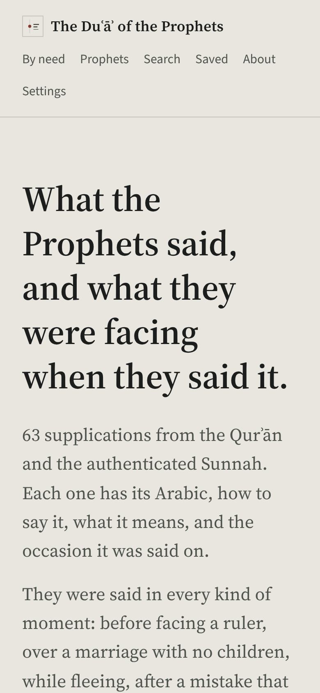

# The Duʿāʾ of the Prophets

A free website with the supplications of the Prophets from the Qurʾān and the
Sunnah — Arabic, transliteration, English and Turkish translation, and the
occasion each was said on — for anyone looking for the right words to pray.

### **[Open the site →](https://candanumut.github.io/dua/)**

Works on your phone; add it to your home screen. After the first visit the
whole site works offline.

<p>
  
  
  
</p>

## What you get

- 63 entries: 57 from the Qurʾān, 5 from the Sunnah, and one psalm attributed
  to Dāwūd, which is labelled as coming from outside both.
- Find a duʿāʾ **by need** (sixteen situations, such as grief, a decision or
  forgiveness), **by Prophet**, or with search.
- Each page has the Arabic, a transliteration, an English and a Turkish
  translation with the translator named, the source reference, and the
  occasion it was said on. Qurʾānic entries also quote Tafsīr al-Jalālayn.
- The interface is in English or Turkish. Choose which translations to show,
  text size, light or dark, and how honorifics appear.
- Save the ones you return to, and copy the Arabic, the translation, or both
  with the citation.

## How the text is handled

The Qurʾānic Arabic is fetched from a published edition and checked against a
checksum (`content.lock.json`) on every build; it is never typed by hand. The
English translation of the Qurʾān is Marmaduke Pickthall's and the Turkish is
Elmalılı Hamdi Yazır's. The commentary is Tafsīr al-Jalālayn in Feras Hamza's
translation, published at altafsir.com. The five ḥadīth are the one place the
Arabic is entered by hand, and their reference numbers have not yet been
checked against a printed edition — each of those pages says so.

Found a mistake? Please
[open an issue](https://github.com/CandanUmut/dua/issues/new). You do not need
to know how to fix it.

## Private by design

No account, no analytics, no cookies, no third-party scripts or fonts. Your
settings and your saved list are kept in your browser's local storage and
never leave your device. The site is plain static pages served by GitHub Pages.

## Run it yourself

```sh
npm install
npm run dev               # http://localhost:4321/dua/
npm run build             # static site in dist/
npm run typecheck
npm run content:verify    # re-derive the Arabic and compare with content.lock.json
npm run check:arabic      # no Arabic typed into templates
```

`main` is checked and deployed to GitHub Pages by `.github/workflows/content.yml`.
To add or correct an entry, read [CONTRIBUTING.md](CONTRIBUTING.md) first.

More background: [DESIGN.md](DESIGN.md) (type, colour and layout decisions),
[INVENTORY.md](INVENTORY.md) (the content schema and the verified list) and
[AUDIT.md](AUDIT.md) (the audit of the earlier version of the site).

## License

GPL-3.0 for the code ([LICENSE](LICENSE)). The Qurʾānic Arabic and the
Pickthall and Elmalılı translations are out of copyright. Tafsīr al-Jalālayn is
quoted in Feras Hamza's English translation for the Royal Aal al-Bayt Institute
(altafsir.com), with attribution on every page that shows it.
